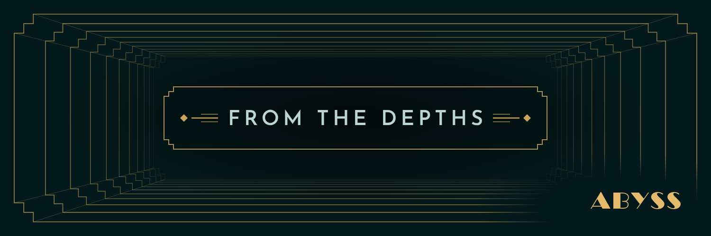

# Abyss Hooks

Contribute pool-bound Uniswap V4 fee hooks to Black Market.

## Submit a hook

1. Copy the [static example](hooks/reference-bound) or [DynamicFeeHook example](hooks/dynamic-fee) into `hooks/<your-hook>`.
2. Declare your author payment and hook-specific fee policy; complete `hook.json` schema 2 with its required `policy`, unchanged `integration.json` schema 2, and `review.md`. Point `test/Smoke.t.sol` at your actual hook artifact and add policy tests.
3. Run local qualification with `--record`, review and commit the compact `provenance.json` with your sources and tests, then open a pull request.

See [CONTRIBUTING.md](CONTRIBUTING.md) for hook requirements and developer royalty terms.

The shared base is oracle-free. The dynamic example opts into the [abstract truncated-oracle template](CONTRIBUTING.md#optional-truncated-oracle) to raise fees on faster observed price rises. Creators choose independent minimum, maximum and sensitivity per pool, frozen at launch. It remains one submitted hook, not another deployment.

Each checked-in `hook.json.policy` describes the formula (explanatory text, never executable),
the three creator fee parameters and their `usedByRate` flags, the runtime oracle/history
dependency, boundary behavior and risks. Migrate `hook.json` version 1 by changing only its
version to 2 and adding this declaration; all other existing fields and the integration
contract stay unchanged. Static policies use only the maximum to calculate the rate;
dynamic policies declare their own parameter usage rather than inheriting a universal
reference formula. `oracle.required: false` does not waive existing oracle factory/config
validation. See the [exact policy contract](CONTRIBUTING.md#hook-manifest-and-policy-declaration).

## Run the checks

Requires Python 3.12 and the [pinned Foundry release](CONTRIBUTING.md#local-checks).

```sh
python3.12 -m pip install -r scripts/requirements.txt
scripts/install-deps.sh
python3.12 scripts/check_hooks.py --hook <slug> --output evidence/<unique-run> --rpc-url https://robinhood.drpc.org --record
```

Replace `<slug>` with your hook folder and `<unique-run>` with a fresh identifier. The runner independently reconstructs the exact artifact, executes mandatory inherited smoke tests and separate contributor policy tests, prints named test results and actual receipts, and writes full logs, JSON and `RESULTS.md` into the ignored output directory. Failed, skipped or incomplete mandatory coverage is not qualification. Only a successful full run with `--record` writes `hooks/<slug>/provenance.json`; it never commits or pushes.

Pools use zero LP fees. The local qualification runner creates isolated Black Market launch contracts from the external source snapshot in `contracts/protocol/`, uses the fork's real venues and the test-configured quote asset, and checks hook-delta accounting and royalty payouts. Test setup and inherited checks are reviewed assumptions, not a sandbox or proof of arbitrary-hook safety. These test deployments are not production registry admission. The dynamic hook's [response matrix](hooks/dynamic-fee/review.md#expanded-response-verification) checks actual charged swaps across creator policies, price rises, observation intervals, idle durations and both trade directions. Sequential trading also checks oracle-clamp catch-up, return to the minimum and reactivation.

Additional [granular regressions](hooks/dynamic-fee/review.md#granular-boundaries-and-trading) execute every second of total signal age from 2 through 300, adjacent-second cap/floor transitions, adjacent raw-unit fee rounding, variable-size exact-input/output swaps, continuous mixed trading and same-timestamp blocks.

Local qualification accepts `--rpc-url https://robinhood.drpc.org` because the default public RPC can reject fork reads with a Cloudflare challenge. Chain ID, fork block and deployed-code hash checks remain mandatory.

For machine-readable launch controls, run `python3.12 scripts/check_hooks.py --structure-only --output evidence/describe-<unique-run>` and read `configurationDescription` in each hook's registration-inputs JSON. It derives typed units, limits and fixed values from the existing integration/base rules and uses `hook.json.policy.parameters` for the three fee settings' descriptions and `usedByRate` annotations. `sourceIdentity.policy` contains the checked-in declaration, bound by existing manifest/source file hashes; the full policy is not duplicated in `configurationDescription`. Apply both the [JSON Schema and cross-field constraint contract](CONTRIBUTING.md#machine-readable-launch-controls), unchanged by this migration. This declared metadata is not runtime proof, an audit, qualification or admission approval, nor a complete launch configuration. `hook.json` remains the sole authored policy source; there is no new registry, payment path or schema file.

Before attaching provenance to a GitHub PR, review the compact record and commit only that file with the selected sources, tests and review. Keep full logs local; never publish credentials, wallet keys or admission secrets. `python3.12 scripts/check_hooks.py --hook <slug> --check-provenance` checks recorded source, test, harness and tool identity without rerunning the chain or proving current-chain behavior. See [Local checks](CONTRIBUTING.md#local-checks) for setup and evidence interpretation.

Automatic CI is temporarily paused. The Hooks workflow is retained for deliberate manual runs after re-enabling it; do not dispatch CI or wait for missing checks during the pause. Run applicable checks locally and disclose that GitHub CI did not run.

Maintainers review each submission. Production registry admission requires separate approval.

## AI agent guidance

[AGENTS.md](AGENTS.md) and the portable skills in `.agents/skills/` are generated with [rulesync](https://rulesync.dyoshikawa.com/). The skills cover hook authoring, qualification, PR review, audit-informed V4 hook security review, and rulesync maintenance. Authoring and security-review guidance link official Uniswap documentation and publicly available audits; using them does not constitute an independent audit. Apply the [PR review skill](.agents/skills/pr-review/SKILL.md) to the complete diff before opening a PR or pushing updates. Self-review does not replace independent maintainer review; inspect exact-head CI when enabled and disclose actual local evidence while it is paused.

Edit `.rulesync/rules/overview.md` or `.rulesync/skills/<name>/SKILL.md`, not the generated files. With Node.js 22 or later, regenerate and check for drift from the repository root:

```sh
npx --yes rulesync@27.0.0 generate
npx --yes rulesync@27.0.0 generate --check
```

Commit `.rulesync/`, `rulesync.jsonc`, `AGENTS.md`, and `.agents/skills/` together so guidance works on a fresh checkout. `rulesync.jsonc` enables only the AGENTS.md and Agent Skills standards; no MCP servers, automatic command hooks, or permissions are configured. Personal overrides go in ignored `rulesync.local.jsonc`.

Generation does not delete existing files. When removing or renaming a canonical skill, explicitly remove its obsolete generated copy. Do not run `rulesync gitignore`, which would ignore outputs this repository intentionally commits.
